  <a href="https://aquifunciona.dev.br"><b>Portfolio</b></a> &nbsp;·&nbsp;
  <a href="https://www.linkedin.com/in/ssampaior"><b>LinkedIn</b></a> &nbsp;·&nbsp;
  <a href="mailto:raabesmps@gmail.com"><b>Email</b></a>

Full Stack Developer with 8+ years building SaaS products in **PHP / Laravel** and **Vue.js**. I like readable code, tests for everything I ship, and turning messy problems into clear products. Right now I am adding data science (Python, SQL) to the toolbox.

**Open to remote mid / senior Full Stack roles.** English C2, Portuguese native, professional Spanish.

<b>🇧🇷 Versão em português</b>

 

Desenvolvedora Full Stack com mais de 8 anos construindo produtos SaaS em **PHP / Laravel** e **Vue.js**. Gosto de código legível, de testes para tudo que entrego e de transformar problemas confusos em produtos claros. Agora estou somando ciência de dados (Python, SQL) à caixa de ferramentas.

**Aberta a vagas remotas Full Stack pleno / sênior.** Inglês C2, português nativo, espanhol profissional.

## Featured projects

<table>
  <tr>
    <td width="50%" valign="top">
      
      WordPress plugin for travel agencies: type a destination, get the best month to go, attractions, a map and a ready-made itinerary. Showcase repo with case study; full source is private.  <a href="https://mes-certo.aquifunciona.dev.br/">Live demo</a>.
    </td>
    <td width="50%" valign="top">
      
      Image editor that runs entirely in the browser: crop, resize, adjust, convert and compress, with Web Workers and WASM encoders. No uploads.  <a href="https://browse-editor.aquifunciona.dev.br/">Live demo</a>.
    </td>
  </tr>
  <tr>
    <td width="50%" valign="top">
      
      Spoiler-safe interactive parchment map for a fantasy saga (non-profit fan project, PT/EN). Procedural art, shareable URL state, keyboard focus and reduced-motion support.   <a href="https://erilea.aquifunciona.dev.br/">Em andamento</a>
    </td> 
  </tr> 
</table>

## Stack

## How I work

- **Tests are part of the work.** PHPUnit and Vitest; I cover what I create or change.
- **Automate the boring parts.** CI with GitHub Actions, Docker for dev and deploy.
- **Plan in writing first.** Each project starts with a planning doc, then small, reviewed steps.
- **Accessible by default.** WCAG AA in Mês Certo, keyboard focus and `prefers-reduced-motion` in the map.
- **AI as a pair programmer.** I use Claude daily and build custom skills for code review.

